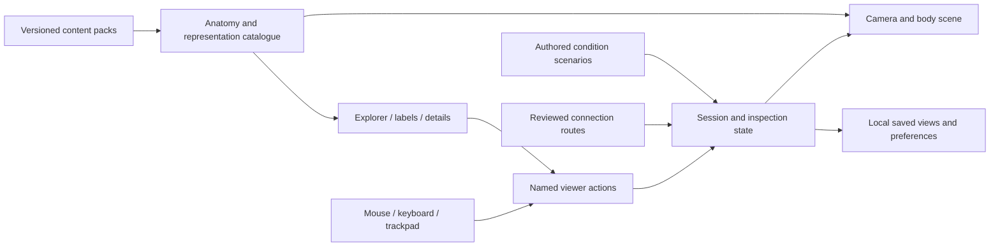

# Architecture — Proposed

Status: target architecture with an initial Godot 4.7.2 feasibility implementation.
The prototype implements a subset; complete engine acceptance and platform testing
remain open. See [PROTOTYPE.md](PROTOTYPE.md).

## Engine recommendation

Use Godot as the initial engine candidate. Its MIT licence supports commercial
distribution subject to its notices; application content has separate licensing.
[Godot licence](https://godotengine.org/license/)

Godot documents native [Windows exports](https://docs.godotengine.org/en/stable/tutorials/export/exporting_for_windows.html)
and [macOS exports](https://docs.godotengine.org/en/stable/tutorials/export/exporting_for_macos.html),
including Universal 2 Mac bundles. It also provides an
[XR system](https://docs.godotengine.org/en/stable/tutorials/xr/setting_up_xr.html).
These capabilities make it a reasonable candidate; they do not establish viewer
performance or make a future VR port automatic.

The proposed stack is Godot with GDScript, native Godot UI controls, Blender for
offline asset preparation, GLB for portable geometry, JSON for metadata and saved
state, and small Python tools for content processing and validation.

The first trial pins Godot 4.7.2 and uses its Compatibility renderer. These are
prototype defaults, not a completed renderer comparison or minimum-hardware claim.
Application licence selection remains separate and open.

## Responsibilities

A single continuous body scene is a user experience requirement, not a requirement
to load every high-detail mesh at once. Keep world placement consistent while
loading regional detail as needed.

- **Catalogue:** stable anatomical IDs, representations, references, capability flags.
- **Viewer:** rendering, picking, highlighting, camera focus, labels, cutaways.
- **Inspection:** reversible visibility, displacement, and separation commands.
- **Pathways:** explicit reviewed connections and route guidance.
- **Scenarios:** authored medical changes, separate from inspection transforms.
- **Persistence:** versioned local views, notes, preferences, and recovery.
- **Content processing:** validate and prepare data without coupling it to UI code.

## State and coordinate contracts

Record source coordinate frame, units, anatomical directions, body identity, and
registration transforms. Normalize in the preparation pipeline and validate placement
against landmarks. Do not fit unrelated assets together only by appearance.

Original anatomy is immutable session baseline data. User visibility, displacement,
camera, and selection are separate. Disease representations are another layer with
explicit reset. Undo/redo uses named commands; history navigation is not identical
to undo.

Canonical anatomical IDs map to one or more geometry nodes in each representation.
Do not require anatomical IDs to equal vendor node names.
[Data model](DATA_MODEL.md) explains groups, missing geometry, and alternative models.

## Geometry and labels

Godot's import documentation covers supported formats and runtime scene loading.
Validate the chosen GLB import path before adopting a packaging method.
[3D import documentation](https://docs.godotengine.org/en/stable/tutorials/assets_pipeline/importing_3d_scenes/index.html)

Use prepared selectable anatomy, pick proxies where needed, selection outlines,
and screen-space labels anchored to actual geometry. Handle transparency, depth,
occlusion, hidden-object picking, and small targets explicitly.

Prepared organ interiors and validated cutaways are the first approach. General
clipping requires tested surfaces and caps. A discarded outer surface cannot supply
missing anatomical contents.

## Rendering and performance

Evaluate Compatibility and Mobile rendering during the feasibility trial, selecting
one measured default with tested fallback behaviour. The name Mobile does not limit
that renderer to phones. Godot documents different feature and hardware trade-offs.
[Renderer overview](https://docs.godotengine.org/en/stable/tutorials/rendering/renderers.html)

Reduce cost through regional loading, levels of detail, restrained materials,
instancing where appropriate, and label budgeting. Preserve selectable small
structures when switching detail. User-facing controls describe visual detail,
not engine internals.

Proposed target: smooth navigation at 1080p, at least 30 sustained FPS on the agreed
baseline laptops and 60 FPS where practical. Define load, memory, and interaction
budgets against measured hardware before declaring minimum requirements. These are
targets, not achieved measurements.

## Local content and persistence

Bundle a usable starter collection so the first session is understandable. Later
regional packs can be explicitly acquired and used offline. Keep metadata available
when high-detail geometry is unloaded.

Pack manifests specify versions, structure mappings, compatible application/schema
versions, checksums, licences, review evidence, and supported capabilities. Validate
packs before activation; keep a known working version and recover from interrupted
updates. Remote packs contain data, not arbitrary executable extensions.

Save user data outside the installation directory, with versioned migrations,
atomic writes, backups, and export/import. Godot supplies a persistent user-data
location; the application still needs its own recovery design.
[Data paths](https://docs.godotengine.org/en/stable/tutorials/io/data_paths.html)

No backend, login, cloud sync, runtime AI tutor, or automatic telemetry is required.
If introduced later, each needs a specific product reason and a separate design.

## Distribution and future devices

Propose Windows x64 and a universal macOS build. Define actual OS support after
testing the pinned engine. Direct downloads are the initial distribution proposal.
[Release requirements](COMPLIANCE.md) cover signing and Mac notarization.

Keep semantic content, routes, saved-view definitions, and representation manifests
portable. Mobile and VR reuse those assets but require new controls, UI, performance
work, and device testing. Do not imply that engine export alone completes a port.
