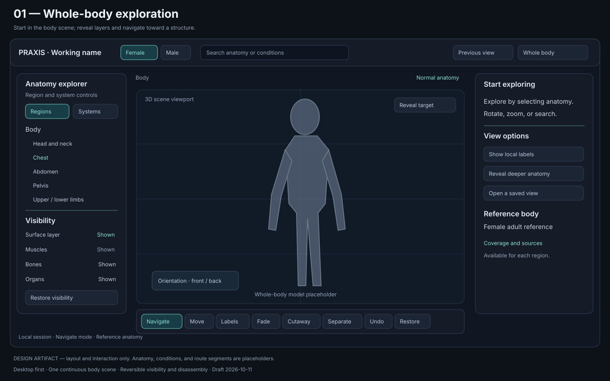
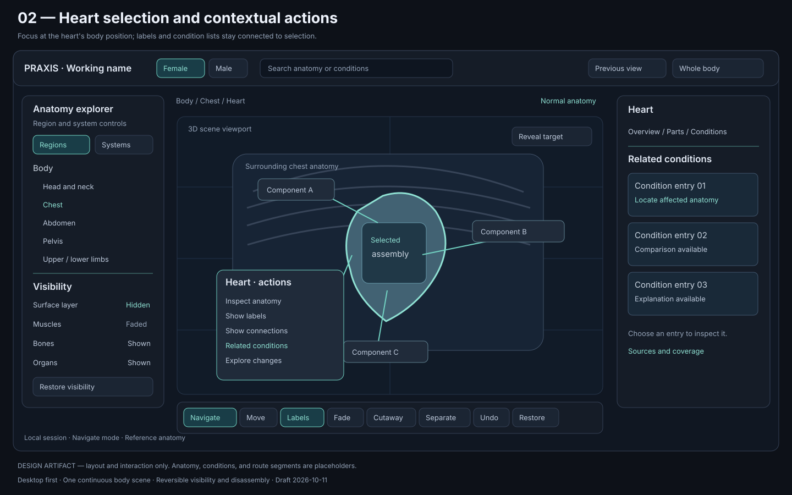
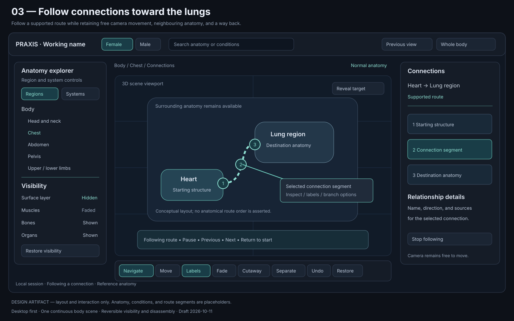

# Desktop Interface Specification

Status: reviewable layout and behaviour proposal, 2026-10-11. These are static
wireframes, not an application or validated medical models.

## Screen studies

### Whole-body exploration

Open directly into the reference body. The left explorer controls region/system
visibility; the right panel explains available actions. Search and body switching
remain available without a separate home screen.

### Heart selection

Focus stays at the heart's position within the body. A compact anchored menu offers
anatomy, labels, connections, conditions, and changes. Longer content stays in the
right panel. Component labels and condition entries in this sketch are placeholders.

### Pathway exploration

The route panel and controls support selecting connections while keeping camera
movement free. The schematic boxes and dashed route illustrate layout only; they
do not establish anatomical placement, flow, or the actual heart-to-lungs route.

## Layout behaviour

The centre remains the primary workspace. Both side panels can collapse independently.
When space is constrained, use one side panel at a time or narrower compact panels;
do not cover the selected structure with stacked floating windows.

Proposed design reference is a 1440 by 900 desktop window. Also evaluate 1280 by 800
and enlarged UI/text settings. Treat these as design samples rather than fixed
minimum requirements. Reserve at least half the available width for the scene when
panels are open; if that cannot be retained, collapse panels.

The top bar holds reference-body choice, search, current context, history, and body
overview. The bottom provides named tools. Tooltips and a controls reference explain
gestures. Shortcuts supplement visible actions.

## Anatomy explorer

Regions and systems are alternate ways to find the same anatomy, not separate
models. A structure can belong to multiple groupings without duplicating it.

Each group supports visibility and opacity. Mixed visibility is distinguishable
from all-shown and all-hidden. A structure hidden through one grouping appears
consistently in other groupings. The full state is derived from individual anatomy
visibility rather than contradictory duplicate group flags.

Reveal target temporarily removes relevant obstruction. Record what changed so
undo or restore visibility recovers the user's previous settings. A reveal action
does not hide everything outside an organ by default.

## Selection and contextual menu

Click or activate a list result to select and focus. Distinguish click from orbit
drag with a tested movement threshold; act on release rather than starting a camera
transition when the pointer is first pressed.

Selection is shared by geometry, labels, lists, and the details panel. Use an outline,
readable name, and optional colour. Selection persists when the menu is closed.

The anchored menu has a small fixed action set. Related conditions opens the panel,
rather than projecting a large disease list across the model. Reposition the menu
when it would obscure the selected part or leave the window.

Supported actions: Inspect anatomy, Show labels, Show connections, Related conditions,
Explore changes, Hide/fade, Move, Separate, Restore. Group secondary inspection
actions behind a small submenu if the menu becomes crowded.

## Details panel

Use Overview, Parts, Connections, Conditions, and Sources sections. Overview gives
a short explanation and an expandable detailed version. Parts lists supplied
components, including a text selection route for small geometry.

Connections states the relationship type and offers supported routes. Conditions
lists actual available entries and distinguishes highlight, comparison, and scenario
capabilities. Sources exposes provenance and review evidence when relevant to learning.

Empty sections say that coverage is unavailable; do not populate them with
automatically generated medical text.

## Navigation, movement, and recovery

| Action | State affected | State preserved |
|---|---|---|
| Select/focus | Selection and camera history | Visibility, ordinary inspection, saved views. |
| Reveal target | Reversible visibility | Original anatomy, scenario, body identity. |
| Move anatomy | Inspection transform | Anatomical baseline and relationship records. |
| Guided separation | Authored inspection offsets | Scenario/medical content identity. |
| Restore selected/group | Relevant inspection transforms | Camera and unrelated inspection state. |
| Restore all inspection | Visibility/displacements according to chosen scope | Medical normal/condition choice. |
| Return to normal | Scenario changes | Camera and compatible ordinary inspection preferences. |
| Whole-body view | Camera framing/local label density | Current body, history, saved views. |
| Switch reference body | Body-specific representation and framing | Corresponding structure/settings where supported. |

Restore opens a clearly labelled scope chooser; restoring geometry and resetting a
condition are distinct. Undo is available for inspection changes. Viewer undo
shortcuts do not override text editing undo while notes/search fields have focus.

Only explicit Move mode drags anatomy. Navigate mode always rotates/pans the view.
The active mode stays visible. A quick return to Navigate avoids accidental moves.

## Label states

Selection-only is the default. Enable a local part set when inspecting a structure.
System labels are an explicit broader option. Keep a configurable density limit.

Persist the user's label preference while deriving which local set is relevant to
the current focus. Previously visited organs should not leave all their labels
visible when moving elsewhere.

If geometry is absent or occluded, label behaviour must be deliberate. Offer a text
list or reveal action instead of placing a misleading label on a nearby surface.

## Pathway controls

Start from Show connections, select a supported route, and display its name,
relationship meanings, supported segments, and branch choices. Previous/next helps
orientation but does not lock the camera. Pause leaves the current structure selected.
Stop following returns ordinary exploration without losing the camera position.

Route steps select anatomy in the same catalogue. Gaps are visible; do not silently
animate through missing anatomy. Route direction is recorded medical content rather
than inferred from the user's camera travel.

## Condition and scenario controls

A condition highlight is available only for supported affected structures. Clear
state identifies the selected condition and an action returns to normal.

A comparison preserves matching anatomical orientation. If a second viewport is
used, share camera direction and framing while explicitly identifying normal and
condition representations. Explain incompatible/missing content.

An injury selector offers only authored choices. Changing parameters selects a
prepared scenario, not unrestricted predictive simulation. If a scenario replaces
geometry, preserve only inspection state supported by its representation mappings;
provide a recoverable reset for incompatible displaced components.

## Loading and failure states

- Starter content opens a useful body overview without requiring an account.
- Regional detail loads without unexpectedly changing camera or selection.
- A missing optional pack identifies unavailable detail and offers an intentional
  acquisition action when a source is configured.
- Failed pack validation keeps the previous working content.
- Missing saved-view content offers a partial restore with a clear coverage explanation.
- A selected structure lacking a condition visual still offers its supported
  explanation without a fabricated comparison.

Technical internals belong in diagnostics, not ordinary anatomy menus.

## Review tasks

The private prototype implements a **Saved views** window with named snapshots,
reference/structure context, save, restore, rename and confirmed deletion. It preserves
inspection return state and validates content identity before scene changes. An older
quick save remains accessible. Local backup recovery is exposed only when the library
cannot be read; source mismatch cannot trigger a partial or invented anatomy restore.
See [the prototype controls](PROTOTYPE.md) for current behaviour. Broader schema
migration and the proposed partial-restore design above remain unimplemented.

Evaluate the three sketches against the primary journey. Confirm that:
selection is readable; labels/menu do not block anatomy; reveal is understandable;
camera/move modes are distinct; pathways retain context; restore scopes make sense;
and controls work with trackpad, keyboard, enlarged text, and reduced motion.

See [Interaction design](INTERACTION_DESIGN.md) for the full journey and
[Acceptance criteria](RELEASE_CRITERIA.md) for future validation.
